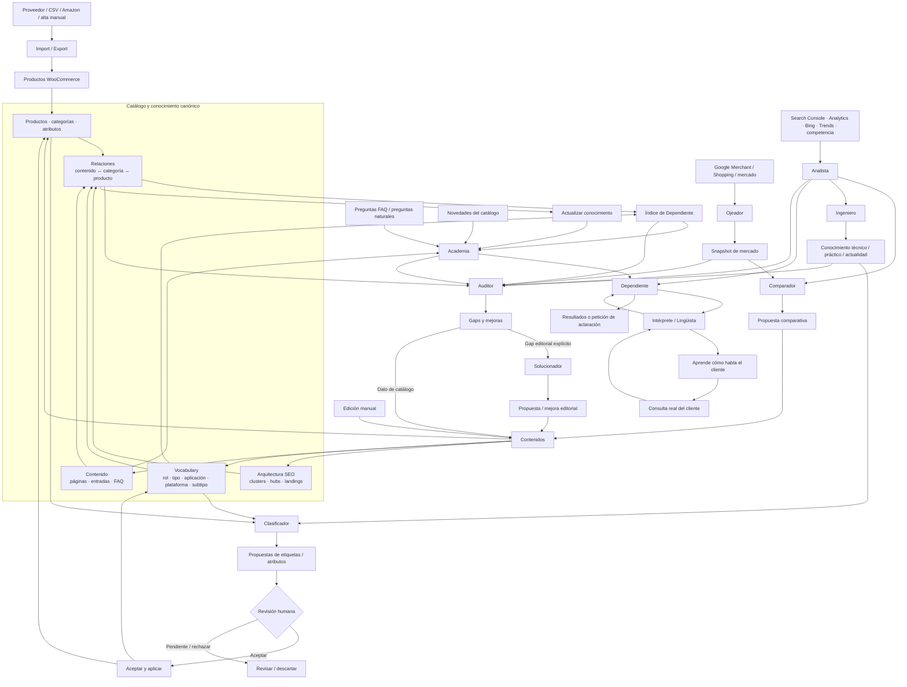

# Inicio

Ruta: **TaxoCommerce SEO → Inicio**

La pantalla Inicio es el punto de entrada al plugin. No modifica datos por sí misma: presenta el objetivo del sistema, un flujo de trabajo recomendado y accesos directos.

## Tarjetas visibles

| Tarjeta | Qué abre | Acción |
|---|---|---|
| Productos | Gestión del catálogo WooCommerce | **Abrir** [Consulta] |
| Categorías | Categorías, arquitectura e inventarios | **Abrir** [Consulta] |
| Páginas | Estructura SEO, landings y corporativas | **Abrir** [Consulta] |
| Entradas | Posts, oportunidades y errores | **Abrir** [Consulta] |
| Imágenes | Inventario, anomalías y asignación | **Abrir** [Consulta] |
| Informes | Informes, anomalías y Analista | **Abrir** [Consulta] |
| Herramientas | Servicios avanzados del plugin | **Abrir** [Consulta] |

El botón **Abrir** solo navega a la pantalla correspondiente.

## Procedimiento recomendado mostrado en Inicio

La guía de Inicio recuerda el orden general: crear/publicar contenido, asignar su función, relacionarlo con Taxonomy, asociar categorías cuando corresponda, comprobar productos y después revisar informes y mejoras. Es una orientación; no ejecuta esos pasos automáticamente.

## Mapa de servicios

| Servicio | Función |
|---|---|
| Import / Export | Incorpora productos, categorías, páginas, entradas y datos de proveedores. |
| Contenidos | Edita productos, categorías, páginas, clusters/hubs, entradas e imágenes. |
| Dependiente | Resuelve necesidades del cliente usando catálogo, semántica, ranking y conocimiento aprendido. |
| Academia | Forma y actualiza a Dependiente con catálogo, contenido, preguntas y novedades. |
| Intérprete / Lingüista | Aprende cómo pregunta el cliente y convierte lenguaje natural en estructura semántica. |
| Ingeniero | Investiga conocimiento externo L1 técnico, L2 práctico/foros y L3 actualidad, con fuente, evidencia y confianza. |
| Clasificador | Detecta huecos y propone etiquetas y atributos canónicos; una propuesta no modifica datos hasta que se acepta y aplica. |
| Ojeador | Observa mercado por categoría, prioriza Merchant cuando está disponible y conserva snapshots de Shopping/mercado. |
| Comparador | Construye perfiles y comparativas utilizando catálogo propio, snapshots de Ojeador y señales de rendimiento. |
| Analista | Interpreta Search Console, Analytics, Bing, tendencias, competencia y rendimiento para priorizar oportunidades. |
| Auditor | Mide calidad, cobertura, coherencia y arquitectura interna; contextualiza hallazgos con señales persistidas de otros servicios. |
| Solucionador | Convierte gaps editoriales explícitos en propuestas o mejoras de contenido; no publica automáticamente. |

Para reconocer qué tablas pertenecen a cada servicio y distinguir datos canónicos, derivados y de runtime, consulta **[[Servicios y tablas|Servicios-y-tablas]]**.

## Flujo general de información

### Lectura rápida

**Importamos o editamos → consolidamos catálogo, arquitectura, Vocabulary, contenidos y relaciones → Academia/Dependiente aprenden → Ingeniero aporta evidencia externa → Clasificador propone y la revisión humana decide si se aplica → Ojeador observa mercado → Comparador prepara comparativas → Analista prioriza con rendimiento y demanda → Auditor detecta gaps → Solucionador y Contenidos corrigen → el conocimiento vuelve a actualizarse.**

Reglas importantes:

- **Catálogo canónico no es una única tabla**: es el conjunto de catálogo WooCommerce, arquitectura SEO, Vocabulary, contenidos y relaciones aceptadas.
- **Ingeniero no escribe directamente en Dependiente**: aporta evidencia y conocimiento externo que otros servicios estructuran o consumen.
- **Clasificador propone antes de modificar**: la ruta visible es **Propuesta → Revisión humana → Aceptar y aplicar → dato canónico**.
- **Ojeador observa mercado; Comparador construye comparativas**: los snapshots de mercado no son catálogo propio.
- **Analista prioriza; no sustituye a Auditor, Ingeniero, Ojeador ni Solucionador**.
- **Auditor no corrige automáticamente**: señala huecos y anomalías para revisión.
- **Intérprete no aprende catálogo ni respuestas**: aprende cómo habla el cliente; catálogo y Vocabulary siguen siendo la verdad.
- **Academia es el puente de aprendizaje de Dependiente**: estudia el catálogo inicial, las preguntas y las actualizaciones posteriores.
