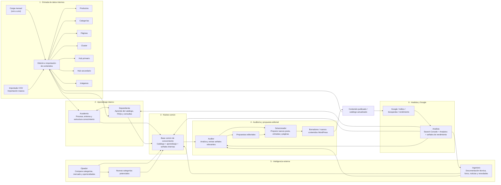

# Flujo de datos del ecosistema SEO Taxonomy

Esta página es la **referencia canónica** del movimiento de información dentro de SEO Taxonomy.

Su objetivo es doble:

1. que una persona pueda entender visualmente cómo se alimenta el sistema;
2. que un agente automático pueda reconstruir el flujo sin depender de una imagen.

> **Regla:** el diagrama Mermaid y la tabla de relaciones de esta página son la fuente de verdad del flujo. La infografía visual puede usarse para presentación, pero no sustituye esta definición estructurada.

## Diagrama principal

## Lectura funcional

### 1. Entrada de datos internos

El sistema recibe información mediante:

- edición manual, uno a uno;
- importaciones masivas mediante CSV.

Los objetos principales que entran al sistema son:

- productos;
- categorías;
- páginas;
- páginas de **cluster**;
- páginas de **hub primario**;
- páginas de **hub secundario**;
- imágenes.

Estas entidades constituyen la base del catálogo y de la arquitectura SEO.

### 2. Academia y Dependiente

La información interna alimenta dos piezas de aprendizaje:

- **Academia** procesa y estructura conocimiento;
- **Dependiente** aprende del catálogo, FAQs, vocabulario y consultas reales de usuarios.

Academia y Dependiente pueden intercambiar señales y conocimiento supervisado.

Ambos alimentan la **base común de conocimiento**.

### 3. Base común de conocimiento

La base común representa el punto lógico donde confluyen:

- catálogo;
- taxonomía;
- aprendizaje interno;
- señales de uso;
- conocimiento externo;
- información de rendimiento.

No implica necesariamente una única tabla física. Es un **concepto arquitectónico común**.

### 4. Auditor → Solucionador → contenido

**Auditor** analiza la información acumulada y detecta:

- carencias;
- incoherencias;
- oportunidades;
- cobertura insuficiente;
- necesidades de mejora.

Auditor entrega señales a **Solucionador**.

**Solucionador** transforma esas señales en decisiones editoriales, por ejemplo:

- crear un post;
- crear una página;
- mejorar contenido existente;
- consolidar información;
- esperar más conocimiento;
- descartar una propuesta.

La salida no se publica automáticamente: pasa por **propuesta / revisión / draft**.

### 5. Ojeador

**Ojeador** aporta inteligencia de mercado:

- compara categorías y productos;
- observa oferta externa;
- detecta oportunidades comerciales;
- detecta categorías potenciales que aún no existen en el catálogo.

Las categorías nuevas detectadas vuelven al flujo como **candidatas**, no como altas automáticas.

Ojeador alimenta la base común y las decisiones posteriores de Auditor/Solucionador.

### 6. Ingeniero

**Ingeniero** aporta conocimiento externo sobre categorías y productos:

- documentación técnica;
- fabricantes;
- manuales;
- normativa;
- foros y experiencia práctica;
- noticias;
- novedades y tendencias.

Su conocimiento se clasifica y entra en el flujo común para enriquecer la base, Auditor y las futuras propuestas editoriales.

### 7. Analista

**Analista** interpreta señales externas de rendimiento:

- Google Search Console;
- Google Analytics;
- tráfico;
- consultas;
- clics;
- posicionamiento;
- comportamiento;
- tendencias detectadas.

Analista alimenta principalmente:

- **Dependiente**, para entender demanda real y mejorar respuestas;
- **Ingeniero**, para decidir qué investigar;
- **Auditor/Base común**, como señal de prioridad y rendimiento.

### 8. Bucle de mejora continua

Cuando una propuesta se convierte en contenido y se publica:

1. pasa a formar parte del catálogo/contenido de la tienda;
2. empieza a generar impresiones, visitas, clics y consultas;
3. Google y Analytics generan nuevas señales;
4. Analista interpreta esas señales;
5. Dependiente e Ingeniero reciben nuevos criterios de aprendizaje/investigación;
6. Auditor vuelve a evaluar la situación;
7. Solucionador puede proponer nuevas acciones.

Por tanto, el sistema es un **ciclo continuo**, no una cadena lineal.

---

## Relaciones canónicas para agentes automáticos

Esta tabla expresa el mismo diagrama de forma explícita. Si existe ambigüedad visual, debe prevalecer esta tabla.

| Origen | Destino | Tipo de información |
|---|---|---|
| Carga manual | Edición e importación | Datos internos |
| Importador CSV | Edición e importación | Datos internos masivos |
| Edición e importación | Productos | Catálogo |
| Edición e importación | Categorías | Taxonomía |
| Edición e importación | Páginas | Contenido |
| Edición e importación | Cluster | Arquitectura SEO |
| Edición e importación | Hub primario | Arquitectura SEO |
| Edición e importación | Hub secundario | Arquitectura SEO |
| Edición e importación | Imágenes | Medios |
| Edición e importación | Academia | Material de aprendizaje |
| Edición e importación | Dependiente | Catálogo y contenido |
| Academia | Dependiente | Conocimiento entrenado |
| Dependiente | Academia | Señales / aprendizaje supervisado |
| Academia | Base común | Conocimiento estructurado |
| Dependiente | Base común | Consultas, señales y conocimiento interno |
| Base común | Auditor | Corpus a auditar |
| Auditor | Solucionador | Hallazgos y necesidades |
| Auditor | Propuestas editoriales | Señales convertibles en acciones |
| Propuestas editoriales | Solucionador | Candidatos editoriales |
| Solucionador | Borradores WordPress | Nuevos contenidos / mejoras |
| Ojeador | Base común | Mercado y comparación |
| Ojeador | Nuevas categorías potenciales | Oportunidades fuera del catálogo |
| Nuevas categorías potenciales | Base común | Candidatos de ampliación |
| Ingeniero | Base común | Conocimiento externo |
| Ingeniero | Auditor | Evidencias externas |
| Google / Analytics / Search Console | Analista | Rendimiento y demanda |
| Analista | Dependiente | Señales de demanda y uso |
| Analista | Ingeniero | Prioridades, tendencias y temas a investigar |
| Analista | Base común | Señales de rendimiento |
| Analista | Auditor | Prioridades de revisión |
| Borradores WordPress | Contenido publicado | Revisión y publicación |
| Contenido publicado | Google / Analytics / Search Console | Nuevas señales |
| Contenido publicado | Edición e importación | Retroalimentación del catálogo |

## Responsabilidades

| Servicio | Responsabilidad principal |
|---|---|
| Academia | Aprender y estructurar conocimiento interno |
| Dependiente | Comprender consultas y responder con catálogo/conocimiento interno |
| Auditor | Detectar problemas, carencias y señales de mejora |
| Solucionador | Convertir señales en propuestas editoriales |
| Ojeador | Observar mercado, competencia y oportunidades de catálogo |
| Ingeniero | Investigar conocimiento externo técnico, práctico y actual |
| Analista | Interpretar comportamiento, demanda y rendimiento externo |

## Reglas de arquitectura

1. **No crear motores paralelos si un servicio existente ya tiene esa responsabilidad.**
2. **Auditor analiza; Solucionador propone.**
3. **Ingeniero investiga; no publica.**
4. **Ojeador observa el mercado; no crea categorías automáticamente.**
5. **Analista prioriza mediante datos de rendimiento; no sustituye a Ingeniero ni a Solucionador.**
6. **Dependiente aprende del catálogo y del uso real, pero no rastrea Internet por sí mismo.**
7. **La publicación siempre genera nuevas señales que deben volver al sistema.**

## Formato para humanos y máquinas

La representación oficial de este flujo se mantiene en tres capas:

1. **Infografía visual**: para dirección y lectura rápida.
2. **Mermaid**: diagrama vectorial/textual versionable en Git.
3. **Tabla origen → destino**: representación explícita para agentes automáticos, auditorías y futuras implementaciones.

Para mantener el flujo actualizado, cualquier cambio de responsabilidad entre servicios debe modificar **esta página** en el mismo desarrollo que modifica el código.
