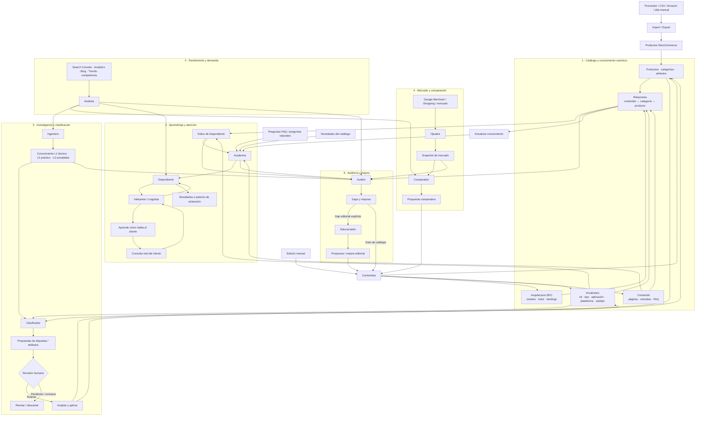
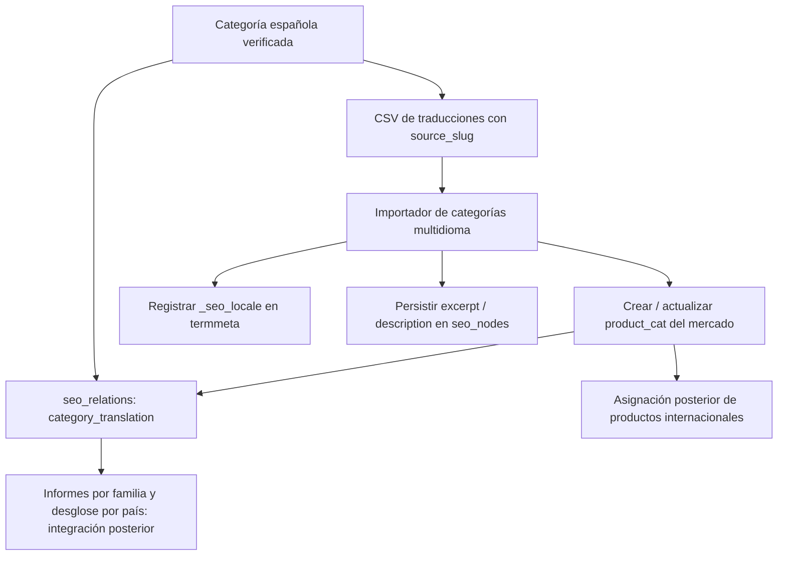

# Flujo de datos del ecosistema TaxoCommerce SEO

Esta página es la **referencia canónica** del movimiento de información dentro de TaxoCommerce SEO.

Su objetivo es doble:

1. que una persona pueda entender visualmente cómo se alimenta el sistema;
2. que un agente automático pueda reconstruir el flujo sin depender de una imagen.

> **Regla:** el diagrama Mermaid y la tabla de relaciones de esta página son la fuente de verdad del flujo. La infografía visual puede usarse para presentación, pero no sustituye esta definición estructurada.

## Diagrama principal

## Flujo internacional: categorías traducidas

La equivalencia `source_slug` → `product_cat` español es explícita y debe verificarse. El proceso **no mueve productos**, no crea redirecciones ni cambia el padre español. Cada destino tiene sus datos WooCommerce y sus propias URLs, pero la relación lógica permite identificar las distintas traducciones de una categoría. Los IDs se resuelven localmente en PRO o STAGING; Clonador debe remapear ambos extremos de `category_translation`.

El importador regional se describe en [[Categorías multidioma|Categorias-multidioma]] y en [Import / Export](../manual/IMPORT-EXPORT.md). Está propuesto en el PR #914; la agregación efectiva de los servicios de informes es trabajo posterior.

## Lectura funcional

### 1. Catálogo y conocimiento canónico

El **catálogo canónico no es una única tabla**. Es el conjunto de datos aceptados que describen:

- productos, categorías y atributos;
- arquitectura SEO: clusters, hubs y landings;
- Vocabulary: rol, tipo, aplicación, plataforma y subtipo;
- contenido: páginas, entradas y FAQ;
- relaciones entre contenido, categorías y productos.

Import / Export y la edición manual pueden alimentar estos bloques. Los servicios derivados no deben convertir automáticamente una señal en dato canónico.

### 2. Academia, Dependiente e Intérprete

- **Academia** procesa catálogo, contenido, preguntas y actualizaciones.
- **Dependiente** usa índice, semántica y conocimiento aprendido para resolver necesidades.
- **Intérprete / Lingüista** aprende cómo formula sus necesidades el cliente y convierte lenguaje natural a estructura semántica.

El aprendizaje se apoya en la verdad canónica, pero sus índices y señales derivadas no sustituyen al catálogo ni al Vocabulary.

### 3. Ingeniero y Clasificador

**Ingeniero** aporta conocimiento externo por capas:

- L1: documentación técnica, fabricantes, manuales, fichas, organismos y normativa;
- L2: foros, comunidades, problemas reales, comparaciones y experiencia práctica;
- L3: noticias, lanzamientos, novedades sectoriales y cambios tecnológicos.

**Clasificador** puede utilizar catálogo y conocimiento de Ingeniero para proponer etiquetas, atributos o valores. La propuesta no es canónica hasta completar la secuencia:

**Propuesta → Revisión humana → Aceptar y aplicar → Vocabulary/atributos canónicos.**

Si la propuesta queda pendiente o se rechaza, no debe modificar la verdad canónica.

### 4. Ojeador y Comparador

**Ojeador** observa el mercado. Prioriza Merchant cuando está disponible y conserva snapshots de Shopping/mercado por categoría y producto.

**Comparador** consume:

- catálogo propio;
- snapshots persistidos de Ojeador;
- señales de rendimiento ya calculadas por Analista.

Su salida es una propuesta/comparativa editorial. Los precios, ofertas o resultados externos siguen siendo evidencia de mercado y no catálogo propio.

### 5. Analista

**Analista** interpreta señales externas de rendimiento y demanda:

- Search Console;
- Analytics;
- Bing;
- tendencias;
- competencia y otras señales persistidas.

Analista prioriza trabajo y aporta contexto a Dependiente, Ingeniero, Comparador y Auditor. No sustituye a esos servicios ni publica cambios por sí mismo.

### 6. Auditor y Solucionador

**Auditor** analiza la calidad y coherencia interna y puede contextualizar hallazgos con snapshots ya persistidos de Analista, Ojeador, Dependiente, Comparador, Ingeniero y proveedores.

**Solucionador** recibe gaps editoriales explícitos y los convierte en propuestas o mejoras de contenido. La publicación sigue requiriendo el flujo editorial correspondiente.

## Relaciones canónicas para agentes automáticos

| Origen | Destino | Tipo de información |
|---|---|---|
| Proveedor / CSV / alta manual | Import / Export | Datos de entrada |
| Import / Export | Productos WooCommerce | Catálogo |
| Edición manual | Contenidos | Contenido y catálogo |
| Productos WooCommerce | Productos/categorías/atributos | Catálogo canónico |
| Contenidos | Arquitectura SEO | Estructura aceptada |
| Contenidos | Vocabulary | Asignaciones manuales aceptadas |
| Contenidos | Contenido | Páginas, entradas y FAQ |
| Catálogo/arquitectura/Vocabulary/contenido | Relaciones | Enlaces estructurales |
| Relaciones | Índice de Dependiente | Fuente canónica para indexación |
| Vocabulary | Índice de Dependiente | Semántica |
| Contenido / FAQ / novedades | Academia | Material de aprendizaje |
| Academia | Dependiente | Conocimiento entrenado |
| Dependiente | Intérprete | Consulta y contexto |
| Intérprete | Dependiente | Interpretación semántica |
| Ingeniero | Conocimiento L1/L2/L3 | Evidencia externa |
| Catálogo + Vocabulary + conocimiento Ingeniero | Clasificador | Señales de clasificación |
| Clasificador | Propuestas de etiquetas/atributos | Propuesta no canónica |
| Revisión humana | Aceptar y aplicar | Decisión |
| Aceptar y aplicar | Vocabulary / atributos | Cambio canónico |
| Google Merchant / Shopping / mercado | Ojeador | Mercado externo |
| Ojeador | Snapshot de mercado | Evidencia persistida |
| Snapshot de mercado | Comparador | Productos/ofertas externos |
| Analista | Comparador | Rendimiento/prioridad |
| Comparador | Contenidos | Propuesta comparativa |
| Search Console / Analytics / Bing / Trends / competencia | Analista | Rendimiento y demanda |
| Analista | Dependiente | Señales de demanda |
| Analista | Ingeniero | Prioridades de investigación |
| Analista | Auditor | Contexto de prioridad |
| Relaciones / índice / Academia / Ingeniero / Ojeador / Analista | Auditor | Corpus y contexto de auditoría |
| Auditor | Gaps y mejoras | Hallazgos |
| Gap editorial explícito | Solucionador | Necesidad editorial |
| Solucionador | Contenidos | Propuesta o mejora |
| Gap de dato de catálogo | Contenidos | Corrección estructural/manual |
| Catálogo actualizado | Academia | Actualización del conocimiento |

## Responsabilidades

| Servicio | Responsabilidad principal |
|---|---|
| Academia | Aprender y estructurar conocimiento interno |
| Dependiente | Comprender consultas y responder con catálogo/conocimiento interno |
| Intérprete / Lingüista | Comprender lenguaje natural y convertirlo a semántica utilizable |
| Ingeniero | Investigar conocimiento externo técnico, práctico y actual |
| Clasificador | Proponer semántica/atributos y aplicar solo tras revisión humana |
| Ojeador | Observar mercado, Merchant/Shopping y oportunidades externas |
| Comparador | Convertir catálogo + mercado + rendimiento en perfiles y propuestas comparativas |
| Analista | Interpretar comportamiento, demanda, rendimiento y competencia |
| Auditor | Detectar problemas, carencias, incoherencias y prioridades internas |
| Solucionador | Convertir gaps editoriales explícitos en propuestas de contenido |

## Reglas de arquitectura

1. **No crear motores paralelos si un servicio existente ya tiene esa responsabilidad.**
2. **Dato observado o propuesta no equivale a dato canónico.**
3. **Clasificador propone; la revisión humana acepta/aplica.**
4. **Ingeniero investiga; no publica ni modifica catálogo por sí solo.**
5. **Ojeador observa mercado; Comparador construye comparativas.**
6. **Analista prioriza mediante rendimiento y demanda; no sustituye a Auditor, Ingeniero, Ojeador, Comparador ni Solucionador.**
7. **Auditor analiza; Solucionador propone actuaciones editoriales.**
8. **Dependiente aprende del catálogo y del uso real, pero no rastrea Internet por sí mismo.**
9. **La publicación y los cambios canónicos generan nuevas señales que deben volver al sistema.**

## Persistencia

El inventario de tablas y su relación con los servicios se mantiene en **[[Servicios y tablas|Servicios-y-tablas]]**. Esa página distingue datos canónicos, persistencia derivada, workflow y runtime regenerable.

## Formato para humanos y máquinas

La representación oficial de este flujo se mantiene en tres capas:

1. **Infografía visual**: para dirección y lectura rápida.
2. **Mermaid**: diagrama vectorial/textual versionable en Git.
3. **Tabla origen → destino**: representación explícita para agentes automáticos, auditorías y futuras implementaciones.

Para mantener el flujo actualizado, cualquier cambio de responsabilidad entre servicios debe modificar **esta página** en el mismo desarrollo que modifica el código.
